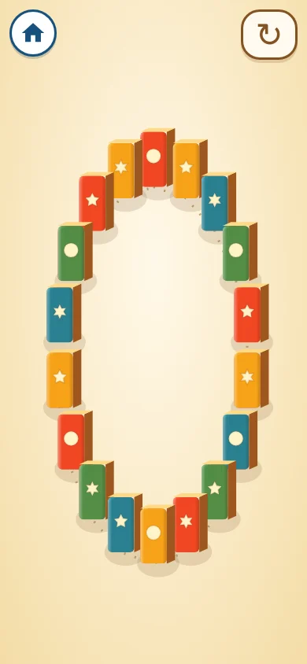

# ころんとドミノ — 実装候補（2026-11-10）

## 狙いと範囲

タップから隣へ伝わる連鎖を主役にした遊び。家を崩す操作・アイスを積む操作・斜面で球を転がす操作と分け、どこを触っても最寄りから一周するようにしました。Canvas 2DなのでWebGLに依存しません。生成した木目を面へ合成し、色と丸・星・花の印を組み合わせます。

[仕様](../../src/koronto-domino/README.md)・[素材来歴](../../source-assets/koronto-domino/README.md)。生成した企画見本と実画面は別物です。画像原本は保持し、WebP配信素材は合計約26KB。追加依存なし。AWS公開対象は変更しません。

## 基準版と公開状態

- GitHub基準main: `dd079475f8233b5691cdc4ae06b21be38d7cf19f`。
- 実装コミット: `02cd70ac1ec1f43a32e76f5a5a44a0492494864b`。ブランチ: `feat/koronto-domino`。main未反映。
- [GitHub作業ブランチ](https://github.com/anipopina/OmochaBox/tree/feat/koronto-domino) に通常push済み。
- 開始時Sites: 版62、source commit `53339ad4ad490c802c5266d666755d89dc3e95be`。
- 版ID: `appgprj_6ad7020cf85c81919ee1984743405a06~appgver_93ac7a5ccb908191a3e85d5b31c01bad`。
- 開始時URL: https://omochabox.ryonchibi.chatgpt.site/ 。新作の公開は未実施。
- 公式Sitesの最新skill resource・troubleshootingと実インストール先を再確認しましたが、`site-workflow.mjs` は取得できません。独自再実装は行わず、既存Sitesのソース・版・デプロイは変更していません。
- 公開URLの入口HTMLは基準mainの通常ビルドとバイト一致（5,299 bytes、SHA-256 `bff8894bf6ef7ae2d0ecaebe37ca87aef12217cc07a9fab47a6a2d31d8c3ed86`）。ただし続く159ファイルのread-only取得はHTTP 403で内容未確認となり、以降の取得は停止しました。入口以外の成果物・Sitesソース全体とmainの一致は未証明です。別履歴のSHAだけで一致とは判断しません。

## 確認範囲

型・lint・整形、通常ビルド、AWS公開範囲、モデル検査、新作のWebGL無効Chromium操作検査は通過。最終の木目・連続変形・補助入力の修正後にも、型・lint・整形・通常ビルド・専用モデル/ブラウザー検査を再実行し通過しています。共通戻るボタンは22作品・3画面サイズで通過。新作は4画面サイズで確認し、非表示・履歴復帰は合成ライフサイクルイベントで検査しています。

### 風船の測定条件の切り分け

風船とおうちバラバラの実装は基準mainから変更していません。最初の方向判定失敗・停止回数588対587について、その瞬間の描画記録がないため原因の完全な特定とは扱いません。

| 検査 | 基準main | 作業ブランチ |
| --- | --- | --- |
| 従来の方向・最大保持停止検査を再実行 | 通過 | 通過 |
| 遅い読み取りを挿入した方向検査 | 初期2フレームは正方向、遅い読み取りは逆方向 | 同じ |
| 描画配送を遅らせた固定時刻の停止測定 | 測定1回→完了2回、旧比較は失敗 | 同じ |
| 修正後の風船全検査・遅延回帰検査 | 通過 | 通過 |

[測定結果](koronto-domino/balloon-timing-results.json)。基準mainの従来テスト全体は、後段の作品数20件固定（実際21件）で失敗しました。修正後の比較では作品一覧から件数を取得しています。描画遅延と1.2秒後の読み取りは競合を再現するための制御条件であり、当初の失敗を無変更の条件で再現したという意味ではありません。

`tests/balloon.mjs` は入力が実際に届いた象限と、その直後の連続する描画2フレームを観測し、縦横の符号を厳密に判定します。最大サイズを初めて描いたフレームが次のRAFを予約していないこと、その後の描画回数が完全一致することも検査します。単に待ち時間や許容差を増やす修正ではありません。観測用fixtureと遅延回帰検査はテストだけに注入し、製品コードには含めません。

### 全体検査の再実行

型・lint・整形は通過。全体の `npm test` を2回再実行し、どちらも既存おえかきの `Release tail <=1.21 seconds`（音声残数1、期待0）で停止しました。音声検査・実装の条件は変更していません。この音声終了の問題は未解決で、全体成功とは扱いません。

後続27コマンドは全て実行し、25件通過・2件失敗でした。ドミノのモデル・4画面サイズ・WebGL無効・連鎖/再開・ライフサイクル検査は通過しました。残る失敗は列車の固定待ち時間後の停止判定（`tests/train.mjs:244`、移動中true、期待false）と、おうちバラバラの連打後の待機状態タイムアウト（`tests/ouchi.mjs:183`）です。前回はいずれも通過していましたが、今回の失敗の原因は未特定です。両作品の実装と失敗した判定は変更せず、失敗したコマンド内の後続項目は未確認として扱います。[後続コマンド別結果](koronto-domino/followup-test-results.json)。共有ブラウザーでの実操作・独立レビュー・実機Safari・音の聴感・幼児操作は未確認。

## 独立レビューの操作

この作業ブランチのプレビュー、または検証版公開後に確認します。現在のSitesには新作はありません。

1. 入口の「ころんとドミノ」から開き、最初の並びを確認。
2. ブロック、輪の中央、画面端を触り、それぞれ最寄りから順番に伝わるか確認。連鎖中に連打・長押し・複数指を試す。
3. 終了後にもう一度触り、配色・並びの変化と再開を確認。途中で矢印ボタンを押して並べ直す。
4. 390×844、320×568、844×390、1440×900で、戻るボタンと積み木が見えることを確認。
5. キーボードの矢印・Space/Enter、動きを減らす設定を確認。
6. 連鎖中にタブ切替・戻る・再入場・画面回転。復帰時に音や連鎖が勝手に再開しないことを確認。
7. 音の連続感・音量・木目と倒れる向きの見分けやすさを評価。実機Safariと幼児操作は未確認。

実画面のヘッドレスChromium画像：

