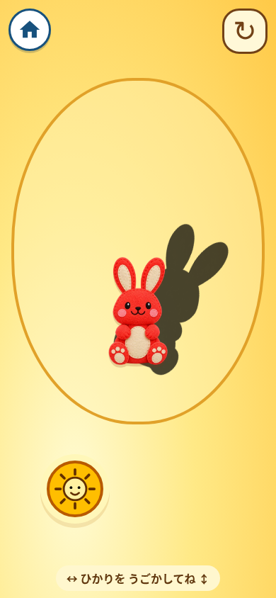
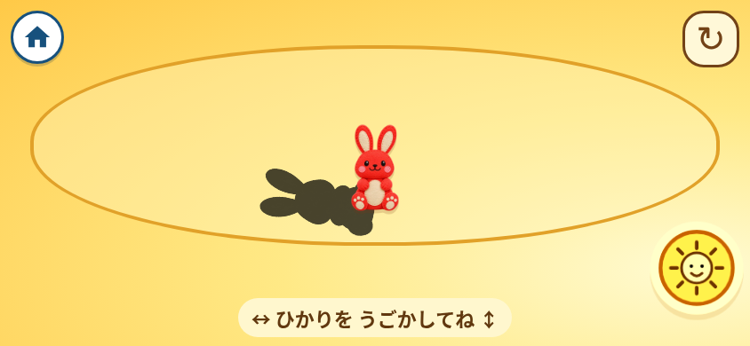
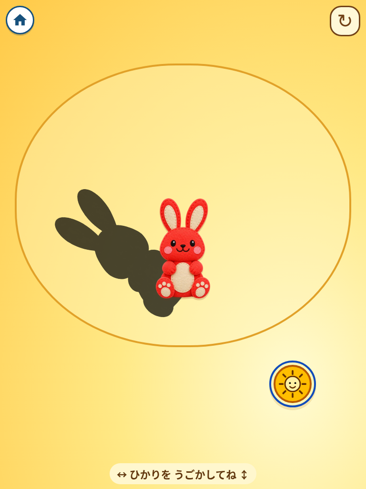

# のびのび、かげあそび — 実装候補（2026-11-11）

独立レビュー前・未公開。基準は GitHub main `3f0ef212adb5e5ebe18c2b3357ec295b3f292aca`。通常表示への追加は行っていません。

## 選定と完成像

既存22作品と初期候補の画像・Markdownを照合。初期6案はすべて実装済みです。新作は太陽形の光源を動かし、同じうさぎの影が反対方向へ伸びたり縮んだりする因果関係を試す遊び。既存のおえかき、引き寄せ、弾性変形とは異なる操作結果を選びました。

黄色の全面フィールド、赤いフェルトのうさぎ、大きく暗い影、指でつかめる太陽。画像生成で制作した透過素材を最適化し、本体・影・入口カードで使用。現在の仕様は [作品README](../../src/kage-asobi/README.md)、素材の来歴は [素材記録](../../source-assets/kage-asobi/README.md) を正本とします。

## 実装側検査

- `npm run check`: 型・ESLint・整形 PASS。
- `npm run test:toy -- kage-asobi`: 通常ビルド、出力素材、入口往復、投影モデル、詳細操作 PASS。
- Chromium: 390×844、1440×900、844×390、320×568、768×1024。
- タップ・ドラッグ、光と影の逆方向、前後による長さの変化、連打、2本指、pointercancel、blur、非表示・復帰、履歴復帰、矢印キー・支援技術クリック、動きを減らす設定を検査。
- 保存済み `omochabox-show-prototypes=false/true` をそれぞれ確認。オフでは新作は隠れ、オンへの切替で開けます。
- 横長画面で長さが上限に固定される問題を検出・修正し、再検査 PASS。
- 実装側でスクリーンショットを目視確認。独立した操作レビューは未実施です。

[詳細結果](kage-asobi-2026-11-11/shadow-results.txt)・[集約結果](kage-asobi-2026-11-11/toy-summary.json)

## 独立レビューの観点

太陽を左右に動かし、影が反対へ動くこと。上下に動かすと伸び縮みを見分けられること。上側を触った際の移動範囲への制限が混乱を生まないこと。指で太陽を隠しても影が見えること。小さい縦長と横向きの両方で、操作の発見・繰返し・戻る操作を確認します。

実機iPhone/iPad Safari、OSジェスチャー、幼児による操作確認は未実施。効果音は未制作・未採用で、音の最終選定・聴感確認はしていません。AWS用ビルド・全詳細回帰は今回の個別追加の検証範囲外です。Sites上の公開と独立レビューを終えるまでは main へ反映しません。
